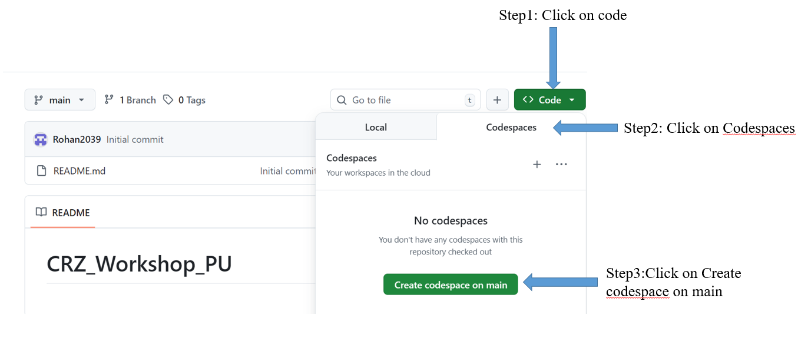
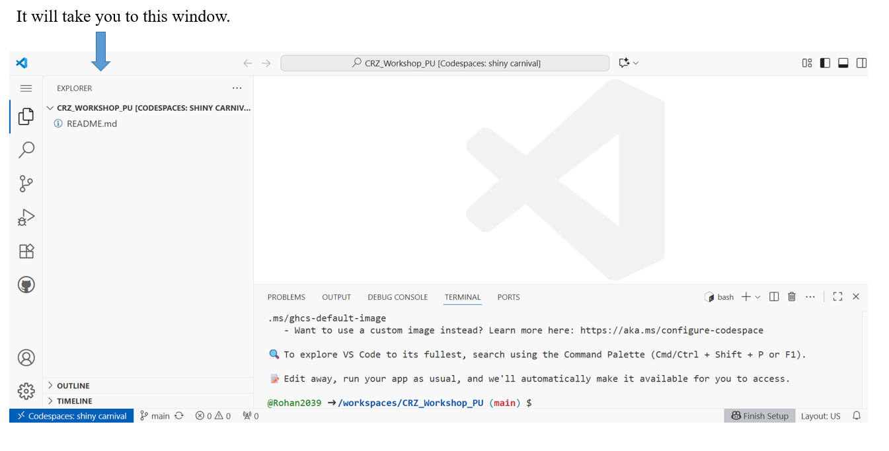
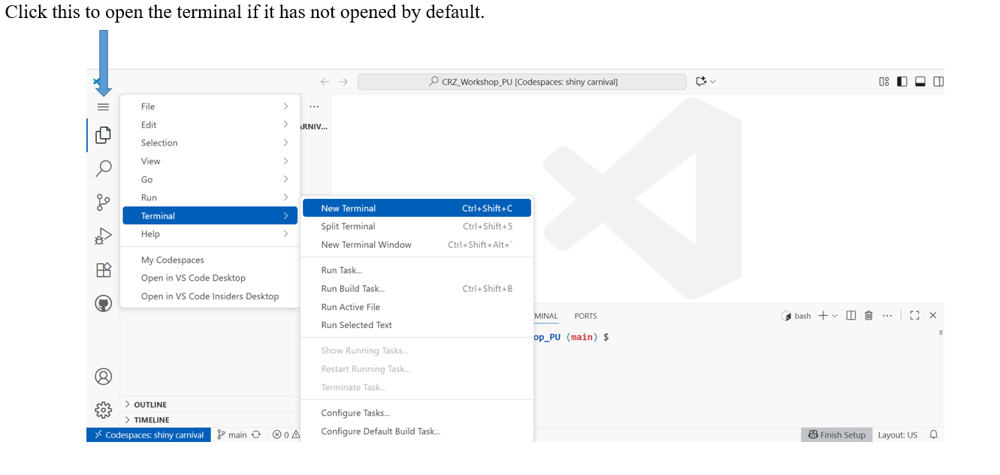

# ⚡ Gear up! 🚀 Follow these steps 📝 to get ready 🎯

## 1. Create a GitHub account.

[Click here to create a GitHub account](https://github.com/signup)

**Note:** If you already have an account, you can skip this step.

## 2. Open the CRZ_WORKSHOP_PU repository.

[Click here to open the repository](https://github.com/Rohan2039/CRZ_Workshop_PU)

## 3. Create a new codespace.

### 3.1 Please follow the steps below to create a codespace.

 
---

 

---

 

## Tools to Install

- ### Run below commands in the terminal.

```bash

sudo apt update
sudo apt install gcc-arm-none-eabi binutils-arm-none-eabi

```
